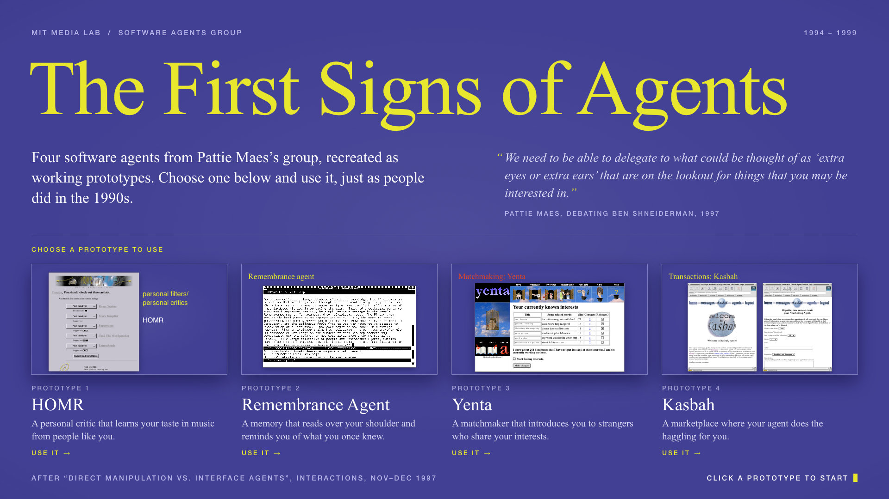

# The First Signs of Agents

**Four software agents from Pattie Maes's Software Agents Group at the MIT Media Lab (1994–1999), recreated as working prototypes you can use in a browser.**



This was made as a keyboard-and-mouse exhibit for an MIT Media Lab alumni event. Each prototype is drawn to match the original interface as it appears in the published figures, mainly those in Shneiderman and Maes's 1997 *interactions* debate, "Direct Manipulation vs. Interface Agents". Behind each screen is a small working version of the idea, so visitors can do a few real things with each agent instead of only looking at a picture of it.

**To try it,** open `index.html` in a browser. There is no build step and no server.

## The prototypes

### 1. HOMR
*Upendra Shardanand, Max Metral & Pattie Maes, 1994–1996*

Rate artists and watch the recommendations change. HOMR finds the simulated members whose taste is closest to yours (constrained Pearson correlation on a 1–7 scale, as in Ringo) and predicts what you will like from theirs.

### 2. Remembrance Agent
*Bradley Rhodes & Thad Starner, 1996*

Type in an Emacs 19 window and watch the bottom three lines suggest old e-mail and notes related to what you are writing. Press `C-c` then `1`, `2` or `3` to open a suggestion.

### 3. Yenta
*Leonard Foner, 1995–1999*

Use Yenta 0.7.0's own pages: let it find your interests, read the messages its clusters carry, and reply to them.

### 4. Kasbah
*Anthony Chavez & Pattie Maes, 1996*

Create a selling agent in Netscape and watch it bargain with buying agents. Its asking price falls from your start price toward your minimum by the deadline, in the linear, quadratic or cubic way the paper describes.

## Running the exhibit

| Where | How |
|---|---|
| A Mac, for the exhibit | Double-click `start.command`. It opens the start page full-screen in Google Chrome's kiosk mode, using a separate throwaway Chrome profile. Press Command-Q to leave. |
| Anywhere else | Open `index.html` in a browser. |

Every page is laid out on a 1920×1080 stage that scales to fit the window, so it looks the same on a laptop screen or an external monitor.

### Controls

- On the start page, click a prototype or press `1`–`4`.
- Inside a prototype, the link at the top left goes back to the start page. The controls at the top right move to the previous or next prototype, or start the current one over.
- A prototype left untouched for 2.5 minutes shows a 15-second notice and then returns to the start page. The start page reloads itself after 15 minutes untouched, to refresh its live previews.

### URL parameters

| Parameter | Effect |
|---|---|
| `?noidle` | Turns off the return to the start page, which is useful while working on a prototype. |
| `?idle=30` | Sets the idle timeout in seconds (minimum 20), for testing it. |
| `?thumb` | Renders a prototype as the live preview used on the start page. |

## Pattie Maes and her group

`group.html` is a second, separate installation: a screen that runs on its own, with nothing to use. It is a timeline of the people in Pattie Maes's group at the Media Lab from 1989 to today. Each row is one person, with a bar for the years they were in the group and, inside it, a word or two for what they worked on. Along the top are the names the group went by. A yellow line walks through the years, a year a second, lighting up whoever was in the group that year and the name the group had then. It rests at today and gives way to a second page, "Conversations to have": five threads that run through the group's work (agents that know what you like, agents that act on your behalf, people and AI, the world as the interface, and memory, sleep and the mind), each listing the people who worked on related ideas, often decades apart, with the people in the group now at the end. One thread after another is picked out while the page is up. After 45 seconds the timeline comes back, grows in again and walks the years once more. A button at the foot jumps straight from one page to the other. The music is "Return To Light", on a loop. It is on whenever the page opens, plays straight through the change of page, and the note in the corner switches it off until the next reload.

To show it, double-click `group.command`. It opens the page full-screen in Chrome with the music allowed to start on its own; in an ordinary browser the music waits for a first click. It needs a modern browser and runs on the same 1920×1080 stage as the exhibit.

The people, their years and their words are in `js/group-data.js`, one entry each, with a note on what is documented and what is estimated. The same file holds the group's names over the years (from the Media Lab's lists of groups in the Wayback Machine), the people in the group now, the themes and who is on each, and a `config` block: `themes: false` turns the themes page off, and `themesSeconds` sets how long it stays. Degree months come from the thesis title pages in MIT's DSpace; arrivals come from CVs, theses and the group's people pages in the Wayback Machine, and default to September where only the year is known. Rows are sorted by arrival when drawn, and the layout makes room for whatever names and roles the file holds. An outlined bar marks years someone spent leading their own group at the Lab.

`?still` shows the chart without the walking line, `?at=1997.5` holds the line at a year, `?nointro` skips the bars growing in, `?themes=off` or `?themes=on` overrides the config, and `?show=themes` opens on the themes page and stays there. The music is `sound/return-to-light.mp3`, converted from `assets/Return_To_Light_2026-10-23T174508.wav` (kept out of the repository) with `ffmpeg -i assets/Return_To_Light_2026-10-23T174508.wav -ar 44100 -c:a libmp3lame -b:a 160k -map_metadata -1 sound/return-to-light.mp3`.

## On Mac OS 9 and other 1990s browsers

The exhibit above needs a modern browser. The `classic/` folder holds a second version of all four prototypes for the browsers of the time: Internet Explorer 5 and Netscape 4 on Mac OS 9, iCab, Classilla, and older browsers back to Netscape 3. It is tested in Netscape Navigator 4 and Internet Explorer 4 for the Mac, on [oldweb.today](https://oldweb.today/).

These browsers cannot run the modern version's JavaScript, so this version needs none. A small Node program does the work on the server, as HOMR, Kasbah and Yenta originally did, and sends plain HTML 3.2 pages with GIF and JPEG images. The agents themselves are the same: Ringo's correlation, the Remembrance Agent's three-scope retrieval, Kasbah's price decay and Yenta's interests and introductions. The page is drawn by the visitor's own period browser, so HOMR's and Kasbah's menus are real Mac OS pop-up menus, and Yenta looks as it did in Netscape on a Mac. The differences from the modern version:

- **The Remembrance Agent looks again each time you press Return**, not after every keystroke. The line with the cursor is a text field; type at the end of it and press Return.
- **Pages reload themselves** while something is happening on its own: Kasbah's agent bargaining, or Yenta finding an interest or getting a reply.
- **A screensaver plays when the exhibit is left alone:** after a minute on the start page, or 5 minutes on the same page of a prototype. It is a recorded visit to all four prototypes, made in Netscape 4 on an emulated Mac and played back as one animated GIF of about 85 seconds, which loops. A line of commentary along its foot says what is happening, step by step. Moving the mouse returns to the start page. That takes the only JavaScript in this version, a few lines that Netscape 3 and 4 and Internet Explorer 4 and 5 can run; without it, a click does the same. The screen icon beside the music note starts the screensaver at once.
- **Every page fits a small browser window,** about 780 by 520 pixels, without scrolling. The label over each prototype is shorter, and Kasbah's form is in two columns.
- **The start page plays music**, "Retro Gadget Waltz", on a loop. It is a plain MP3 that the browser hands to QuickTime (version 4 or later, so any Mac OS 9). A music note in the top right corner switches it off and on: it is a plain link, and a cookie remembers the choice. It plays on the start page only. A modern browser stays silent until the visitor has clicked something on the site.
- **In a modern browser with a large window, the start page is enlarged to fill it.** Browsers of the time ignore that rule and keep the page at its small size.

To run it, with Node 18 or later and nothing to install:

```
node classic/server.js
```

Then open `http://localhost:8040/classic/`. Each visitor gets a short id in the address. Their state is kept on the server for three hours, and forms use GET.

On the exhibit's server, `classic/original-agents-classic.service` runs it under systemd, and Caddy passes `/classic` to it. The OS 9 browsers cannot use modern HTTPS, so this part must stay on plain HTTP. When the domain is added, keep an `http://` site for it or keep using the IP address. The optional `@old` lines send period browsers that open the bare address straight to `/classic/`:

```
:80 {
	@old {
		path /
		header_regexp User-Agent "Mozilla/[1-4]\.|MSIE [2-6]\.|PPC|iCab|Classilla"
	}
	redir @old /classic/
	handle /classic* {
		reverse_proxy 127.0.0.1:8040
	}
	handle {
		root * /srv/original-agents
		encode gzip
		header Cache-Control "no-cache"
		file_server {
			hide .git .gitignore
		}
	}
}
```

The images in `classic/img/` are made from `assets/` and the start-page screenshot by `python3 classic/tools/make_images.py` (Pillow, and Chrome for Kasbah's menu bar). The screensaver, `classic/img/screensaver.gif`, is made by `classic/tools/make_screensaver.py` from screenshots of a recorded session in oldweb.today's Netscape 4. Those screenshots are kept out of the repository; the script's notes say how they were taken. The music, `classic/sound/agents.mp3`, is converted from `assets/Retro_Gadget_Waltz_2026-10-21T171128.wav`. That 23 MB source is kept out of the repository. To convert it again: `ffmpeg -i assets/Retro_Gadget_Waltz_2026-10-21T171128.wav -ar 44100 -c:a libmp3lame -b:a 128k -map_metadata -1 -id3v2_version 0 -write_xing 0 classic/sound/agents.mp3`. That gives an MPEG-1 Layer III file with no tags, which the QuickTime of the time plays.

## How it is made

- **Fidelity.** Layouts, colours and type are measured from the original figures and screenshots, not reconstructed from memory. Where the original artwork survives in a figure (HOMR's banner, Yenta's collage, Kasbah's welcome image), it is cut out and reused. HOMR's screen is the Firefly-era page from the figure; the demo calls it HOMR throughout, so `tools/make_homr_banner.py` replaces the banner's "firefly" wordmark with "HOMR". The original is kept in `assets/firefly/`. Everything else is redrawn in HTML and CSS at the original screen size and enlarged.
- **The Remembrance Agent** is drawn pixel by pixel on a canvas using the original X11 `misc-fixed` bitmap fonts. The text buffer is a small working editor, and the agent is a small working retrieval engine that searches three scopes around the cursor, as the paper describes.
- **The content is invented.** The music ratings, the Remembrance Agent's e-mail and notes, Yenta's messages and Kasbah's buyers are made up for the exhibit, written to be plausible for the mid-1990s. Anything presented as a quotation or a historical fact has been checked against the papers in `references/`.
- **Every visitor sees the same world.** Simulated members and buyers come from a seeded random number generator.

## Project layout

```
index.html          start page
homr.html           prototype 1
remembrance.html    prototype 2
yenta.html          prototype 3
kasbah.html         prototype 4
start.command       opens the exhibit in Chrome kiosk mode (macOS)
group.html          Pattie Maes and her group, the timeline installation
group.command       opens the timeline in Chrome kiosk mode, music on (macOS)
css/                shell.css (shared) and one stylesheet per page
js/                 shell.js (scaling, navigation, idle reset) and one script per page
                    ra-corpus.js   the Remembrance Agent's e-mail and notes
                    xfonts.js      X11 misc-fixed bitmap fonts
                    group-data.js  the people, years, words and themes on the timeline, and its config
sound/              the timeline's music
classic/            the version for 1990s browsers: server.js and one module per prototype,
                    img/ (GIF and JPEG), sound/ (the start page's music),
                    tools/make_images.py, and a systemd unit
tools/              make_homr_banner.py: HOMR's banner, from the figure's firefly banner
assets/             images cut from the original figures (homr/banner.png is the one changed), and the period fonts
references/         the papers the prototypes are based on
screenshots/        the start page image above (other screenshots stay local)
```

## References

These papers are included in [`references/`](references/).

- Ben Shneiderman and Pattie Maes. "Direct Manipulation vs. Interface Agents." *interactions* 4(6), November–December 1997. [`interface_agents.pdf`](references/interface_agents.pdf). The main source for all four screens.
- Pattie Maes. "Agents that Reduce Work and Information Overload." *Communications of the ACM* 37(7), July 1994. [`information_overload.pdf`](references/information_overload.pdf)
- Upendra Shardanand and Pattie Maes. "Social Information Filtering: Algorithms for Automating 'Word of Mouth'." *CHI '95*. [`word_of_mouth.pdf`](references/word_of_mouth.pdf). Ringo, which became HOMR and then Firefly.
- Beerud Sheth and Pattie Maes. "Evolving Agents for Personalized Information Filtering." *Proceedings of the Ninth IEEE Conference on Artificial Intelligence for Applications*, 1993. [`Evolving_agents_for_personalized_information_filtering.pdf`](references/Evolving_agents_for_personalized_information_filtering.pdf)
- Bradley J. Rhodes and Thad Starner. "Remembrance Agent: A Continuously Running Automated Information Retrieval System." AAAI Technical Report SS-96-02, 1996. [`remembrance_agent.pdf`](references/remembrance_agent.pdf)
- Bradley J. Rhodes and Pattie Maes. "Just-in-time Information Retrieval Agents." *IBM Systems Journal* 39(3–4), 2000. [`Just-in-time_information_retrieval_agents.pdf`](references/Just-in-time_information_retrieval_agents.pdf)

These were also used but are not included here:

- Leonard N. Foner. *Political Artifacts and Personal Privacy: The Yenta Multi-Agent Distributed Matchmaking System.* PhD dissertation, MIT, 1999. The source for Yenta 0.7.0's pages.
- Anthony Chavez and Pattie Maes. "Kasbah: An Agent Marketplace for Buying and Selling Goods." *PAAM '96*. The source for Kasbah's selling agents and their price strategies.

The papers and the artwork taken from their figures belong to their authors and publishers. They are included here for reference.
